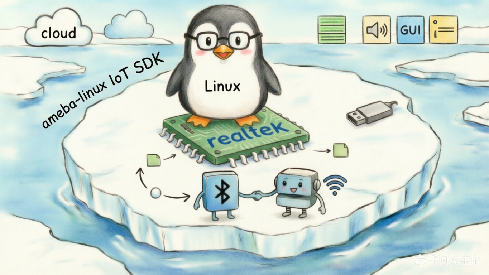

<div align="center">



# tests

**Per-peripheral user-space / kernel-space test-case suite for the ameba-linux IoT SDK.**

[](https://aiot.realmcu.com/en/latest/linux/index.html)
[](#)
[](#)

[English](README.md) · [中文版](README_CN.md) · [Linux SDK Docs](https://aiot.realmcu.com/en/latest/linux/index.html)

</div>

`tests/` is the driver-verification harness for ameba-linux. Each subdirectory targets one peripheral or subsystem and ships a self-contained test bundle: typically a small C program (or a loadable kernel module) + a shell driver script + a `readme.txt` describing hardware wiring and pass/fail criteria. The tests are meant to be run on the target board after flashing an `ameba-full` image; Yocto recipes under [`meta-realtek/meta-realtek-bsp/recipes-test/`](../yocto/meta-realtek/meta-realtek-bsp/recipes-test) package them into the image.

## 🧭 Position in the SDK

```text
┌──────────────────────────────────────────────────────────────┐
│  tests/  ← peripheral bring-up and regression cases          │
│      user space (rtk_*_test)                                 │
│      loadable kernel modules (kmod-*-test.ko)                │
│      shell driver scripts (rtk_*_test.sh)                    │
├──────────────────────────────────────────────────────────────┤
│  Linux 6.18 kernel + Realtek drivers  (sources/kernel/)      │
├──────────────────────────────────────────────────────────────┤
│  Co-processor firmware  (sources/firmware/)  ← e.g. Wi-Fi    │
├──────────────────────────────────────────────────────────────┤
│  Realtek Ameba SoC + external test fixtures                  │
└──────────────────────────────────────────────────────────────┘
```

## 🏗️ Test directories

Each subdirectory is a self-contained test package that Yocto can build individually.

### Peripheral bring-up (user-space `rtk_*_test`)

| Test           | Target subsystem           | Type                     |
|:-------------- |:-------------------------- |:------------------------ |
| `adc/`         | ADC                        | user program + shell driver |
| `audio_pll/`   | Audio PLL                  | user program             |
| `captouch/`    | Cap-touch                  | user program             |
| `clk/`         | Clock / RCC                | user program             |
| `cpu/`         | CPU stress                 | shell driver             |
| `gpio/`        | GPIO (kernel + user)       | user program + kmod      |
| `i2c/`         | I²C master                 | user program + shell driver |
| `i2c-slave/`   | I²C slave                  | loadable kmod            |
| `ir/`          | IR TX/RX                   | user program             |
| `ledc/`        | LEDC / PWM-LED             | shell driver             |
| `misc/`        | Miscellaneous / smoke      | user program             |
| `pwm/`         | PWM                        | user program             |
| `rtc/`         | RTC                        | user program + shell driver |
| `sdioh/`       | SDIO host                  | user program + shell driver |
| `spi/`         | SPI                        | user program + shell driver |
| `spic/`        | SPI controller             | shell driver             |
| `system_timer/`| System timer               | user program             |
| `thermal/`     | Thermal sensor             | user program             |
| `timer_hw/`    | Hardware timer             | loadable kmod            |
| `uart/`        | UART                       | user program             |
| `watchdog/`    | Watchdog                   | user program             |

### Kernel & subsystem tests (loadable modules)

| Test              | Purpose                                     |
|:----------------- |:------------------------------------------- |
| `hello/`          | Minimal user-space "hello world" smoke test  |
| `hello_module/`   | Minimal loadable-kmod smoke test            |
| `crypto/`         | Kernel crypto API bring-up (`kmod-crypto-test.ko`) |
| `dmac/`           | DMA controller (single-channel & multi-channel kmods) |
| `drm/`            | DRM/KMS (`modetest`, `kmstest`, `vbltest`, `proptest`, `modeprint`, `util`) |

### Power management

| Test                | Purpose                     |
|:------------------- |:--------------------------- |
| `pm_wakelock/`      | Wake-lock behaviour         |
| `pm_wakeup_count/`  | Wake-up source counting     |

### USB

| Test              | Purpose                            |
|:----------------- |:---------------------------------- |
| `usb/`            | Top-level USB shell driver         |
| `usbh_cdc_acm/`   | USB host, CDC-ACM class            |
| `usbh_uvc/`       | USB host, UVC (video) class        |
| `usbh_vendor/`    | USB host, vendor class (`testusb`) |

### Wireless

| Test    | Purpose                                              |
|:------- |:---------------------------------------------------- |
| `nan/`  | Wi-Fi Aware (NAN) — proprietary-ioctl test program + wrapper |

### Benchmarks

`benchmark/` packages industry-standard suites:

- `cpuburn-arm` — CPU stress test
- `lmbench3` — micro-benchmarks (memory, syscalls, IPC …)
- `STREAM` — memory bandwidth
- `stressapptest` — Google stress app test
- `tinymembench` — small-vector memory benchmark

## 🧪 Structure of a single test

Most peripheral tests follow the same template:

```
tests/<peripheral>/
├── <peripheral>.c            # User-space source (builds to rtk_<peripheral>_test)
│  or
├── kmod-<peripheral>-test.c  # Loadable kernel module
├── Makefile                  # Cross-build rules (invoked by Yocto)
├── readme.txt                # HW wiring / SW setup / parameters / expected result
└── rtk_<peripheral>_test.sh  # Optional shell driver script
```

`readme.txt` typically has four sections: **[Description]**, **[HW Setup]**, **[SW Setup]**, **[Parameters]**, **[Result]**. Always read the corresponding `readme.txt` before running — many tests require external wiring (loopback jumpers, a second board, a USB-UART dongle, an I²C-slave peer, etc.).

## 🚀 Build and run

### 1. Build an image with tests

From the SDK root (`6.18.y/`):

```bash
# Any full config includes tests; the machine .conf pulls in the tests DTB
source envsetup.sh -m rtl8730elm-va8 -d ameba-full
m
```

Rebuild an individual test package with bitbake:

```bash
bitbake -c cleanall rtk-uart-test
bitbake rtk-uart-test
```

### 2. Boot with a tests DTB

Machine `.conf` files (e.g. `rtl8730elm-va8.conf`) provide separate DTBs per peripheral, to avoid pinmux conflicts with the default rootfs:

```
realtek/ameba/rtl8730elm-va8-tests-adc-diff.dtb
realtek/ameba/rtl8730elm-va8-tests-adc-sig.dtb
realtek/ameba/rtl8730elm-va8-tests-ctc.dtb
realtek/ameba/rtl8730elm-va8-tests-i2c.dtb
realtek/ameba/rtl8730elm-va8-tests-ir-rx.dtb
realtek/ameba/rtl8730elm-va8-tests-ir-tx.dtb
realtek/ameba/rtl8730elm-va8-tests-lcd.dtb
realtek/ameba/rtl8730elm-va8-tests-misc.dtb
realtek/ameba/rtl8730elm-va8-tests-spi.dtb
realtek/ameba/rtl8730elm-va8-tests-uart.dtb
realtek/ameba/rtl8730elm-va8-tests-display.dtb
```

Boot the DTB matching the peripheral under test.

### 3. Run on the target board

```sh
# Example: UART loopback (see tests/uart/readme.txt)
rtk_uart_test -P 2

# Example: I²C master (see tests/i2c/readme.txt)
rtk_i2c_test -W -v
rtk_i2c_test -R -v -l 256

# Example: kernel-module test
insmod kmod-hello-test.ko
```

## 📚 Documentation

- **Ameba Linux SDK User Guide** — https://aiot.realmcu.com/en/latest/linux/index.html
- For per-test details, see the `readme.txt` in each subdirectory.

## 💬 Feedback

Community: [Real-AIOT Forum](https://forum.real-aiot.com/)
