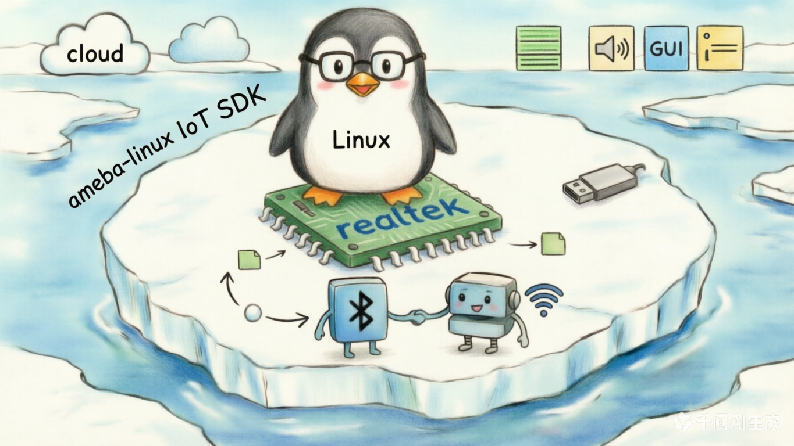

<div align="center">



# tests

**ameba-linux IoT SDK 面向各外设的用户态 / 内核态测试用例集。**

[](https://aiot.realmcu.com/zh/latest/linux/index.html)
[](#)
[](#)

[English](README.md) · [中文版](README_CN.md) · [Linux SDK 文档](https://aiot.realmcu.com/zh/latest/linux/index.html)

</div>

`tests/` 是 ameba-linux 的驱动验证台。每个子目录钉住一个外设或子系统，附带一套自包含的测试：通常一个小 C 程序（或可加载内核模块）+ 一个 shell 驱动脚本 + 一份 `readme.txt`（描述硬件接线和判定条件）。这些测试用于烧完 `ameba-full` 镜像后在目标板上运行，通过 [`meta-realtek/meta-realtek-bsp/recipes-test/`](../yocto/meta-realtek/meta-realtek-bsp/recipes-test) 下的 Yocto recipe 打包进镜像。

## 🧭 在 SDK 中的位置

```text
┌──────────────────────────────────────────────────────────────┐
│  tests/  ← 外设 bring-up 与回归用例                          │
│      用户态 (rtk_*_test)                                     │
│      可加载内核模块 (kmod-*-test.ko)                         │
│      shell 驱动脚本 (rtk_*_test.sh)                          │
├──────────────────────────────────────────────────────────────┤
│  Linux 6.18 内核 + Realtek 驱动  (sources/kernel/)           │
├──────────────────────────────────────────────────────────────┤
│  协处理器固件  (sources/firmware/)  ← 例如 Wi-Fi             │
├──────────────────────────────────────────────────────────────┤
│  Realtek Ameba SoC + 外部测试夹具                            │
└──────────────────────────────────────────────────────────────┘
```

## 🏗️ 测试目录

每个子目录都是可由 Yocto 单独构建的、自包含的测试包。

### 外设 bring-up（用户态 `rtk_*_test`）

| 测试           | 目标子系统                 | 类型                     |
|:-------------- |:-------------------------- |:------------------------ |
| `adc/`         | ADC                        | 用户程序 + shell 驱动    |
| `audio_pll/`   | Audio PLL                  | 用户程序                 |
| `captouch/`    | 电容触摸                   | 用户程序                 |
| `clk/`         | 时钟 / RCC                 | 用户程序                 |
| `cpu/`         | CPU 拉练                   | shell 驱动               |
| `gpio/`        | GPIO（内核 + 用户）        | 用户程序 + kmod          |
| `i2c/`         | I²C master                 | 用户程序 + shell 驱动    |
| `i2c-slave/`   | I²C slave                  | 可加载 kmod              |
| `ir/`          | 红外收发                   | 用户程序                 |
| `ledc/`        | LEDC / PWM-LED             | shell 驱动               |
| `misc/`        | 其他 / smoke               | 用户程序                 |
| `pwm/`         | PWM                        | 用户程序                 |
| `rtc/`         | RTC                        | 用户程序 + shell 驱动    |
| `sdioh/`       | SDIO host                  | 用户程序 + shell 驱动    |
| `spi/`         | SPI                        | 用户程序 + shell 驱动    |
| `spic/`        | SPI controller             | shell 驱动               |
| `system_timer/`| 系统定时器                 | 用户程序                 |
| `thermal/`     | 温度传感器                 | 用户程序                 |
| `timer_hw/`    | 硬件定时器                 | 可加载 kmod              |
| `uart/`        | UART                       | 用户程序                 |
| `watchdog/`    | 看门狗                     | 用户程序                 |

### 内核 & 子系统测试（可加载模块）

| 测试              | 用途                                        |
|:----------------- |:------------------------------------------- |
| `hello/`          | 最简用户态 "hello world" 冒烟测试            |
| `hello_module/`   | 最简可加载 kmod 冒烟测试                    |
| `crypto/`         | 内核 crypto API bring-up（`kmod-crypto-test.ko`）|
| `dmac/`           | DMA 控制器（单通道 & 多通道 kmod）          |
| `drm/`            | DRM/KMS（`modetest`、`kmstest`、`vbltest`、`proptest`、`modeprint`、`util`）|

### 电源管理

| 测试                | 用途                     |
|:------------------- |:------------------------ |
| `pm_wakelock/`      | Wake-lock 行为验证       |
| `pm_wakeup_count/`  | Wake-up source 计数      |

### USB

| 测试              | 用途                              |
|:----------------- |:--------------------------------- |
| `usb/`            | USB 顶层 shell 驱动               |
| `usbh_cdc_acm/`   | USB host，CDC-ACM 类              |
| `usbh_uvc/`       | USB host，UVC（视频）类           |
| `usbh_vendor/`    | USB host，vendor 类（`testusb`）  |

### 无线

| 测试    | 用途                                                 |
|:------- |:---------------------------------------------------- |
| `nan/`  | Wi-Fi Aware (NAN) — 私有 ioctl 测试程序 + 封装        |

### Benchmark

`benchmark/` 打包了业界标准套件：

- `cpuburn-arm` — CPU 压测
- `lmbench3` — 微 benchmark（内存、syscall、IPC …）
- `STREAM` — 内存带宽
- `stressapptest` — Google stress app test
- `tinymembench` — 小向量内存 benchmark

## 🧪 单个测试的组织

大多数外设测试遵循同一模板：

```
tests/<peripheral>/
├── <peripheral>.c            # 用户态源码（编译产物 rtk_<peripheral>_test）
│  或
├── kmod-<peripheral>-test.c  # 可加载内核模块
├── Makefile                  # 交叉编译规则（由 Yocto 调用）
├── readme.txt                # 硬件接线 / 软件配置 / 参数 / 期望结果
└── rtk_<peripheral>_test.sh  # 可选的 shell 驱动脚本
```

`readme.txt` 通常包含四段：**[Description]**、**[HW Setup]**、**[SW Setup]**、**[Parameters]**、**[Result]**。运行前请务必阅读对应 `readme.txt` — 很多测试要求外部接线（回环跳线、第二块板、USB-UART dongle、I²C slave 对端等）。

## 🚀 构建与运行

### 1. 构建带 tests 的镜像

在 SDK 根目录（`6.18.y/`）下：

```bash
# 任何 full 配置都会包含 tests；machine .conf 会拉入 tests DTB
source envsetup.sh -m rtl8730elm-va8 -d ameba-full
m
```

单个测试包可用 bitbake 重编：

```bash
bitbake -c cleanall rtk-uart-test
bitbake rtk-uart-test
```

### 2. 使用 tests DTB 启动

machine `.conf`（例如 `rtl8730elm-va8.conf`）为不同外设提供独立 DTB，避免与默认 rootfs 的 pinmux 冲突：

```
realtek/ameba/rtl8730elm-va8-tests-adc-diff.dtb
realtek/ameba/rtl8730elm-va8-tests-adc-sig.dtb
realtek/ameba/rtl8730elm-va8-tests-ctc.dtb
realtek/ameba/rtl8730elm-va8-tests-i2c.dtb
realtek/ameba/rtl8730elm-va8-tests-ir-rx.dtb
realtek/ameba/rtl8730elm-va8-tests-ir-tx.dtb
realtek/ameba/rtl8730elm-va8-tests-lcd.dtb
realtek/ameba/rtl8730elm-va8-tests-misc.dtb
realtek/ameba/rtl8730elm-va8-tests-spi.dtb
realtek/ameba/rtl8730elm-va8-tests-uart.dtb
realtek/ameba/rtl8730elm-va8-tests-display.dtb
```

按待测外设启动对应 DTB。

### 3. 在目标板上运行

```sh
# 示例：UART 回环（见 tests/uart/readme.txt）
rtk_uart_test -P 2

# 示例：I²C master（见 tests/i2c/readme.txt）
rtk_i2c_test -W -v
rtk_i2c_test -R -v -l 256

# 示例：内核模块测试
insmod kmod-hello-test.ko
```

## 📚 文档

- **Ameba Linux SDK 用户指南** — https://aiot.realmcu.com/zh/latest/linux/index.html
- 具体测试细节 — 见各子目录下的 `readme.txt`。

## 💬 反馈

社区：[Real-AIOT 论坛](https://forum.real-aiot.com/)
